# 管理端一期设计文档

> 范围：管理首页（运营看板）+ 组织用户（组织 / 用户 / 会员 / 角色权限）  
> 技术栈：NestJS 11、Prisma、PostgreSQL、BullMQ、Redis、React Admin、`@agent/contracts`  
> 会员模型：组织可订企业套餐 + 用户可订个人会员，权益按「更高可用额度」合并  
> 本阶段：仅设计规格，不写业务代码

---

## 目录

1. [架构与目录落点](#1-架构与目录落点)
2. [设计模式总览](#2-设计模式总览)
3. [枚举与公共约定](#3-枚举与公共约定)
4. [表结构与 ER](#4-表结构与-er)
5. [功能流程图](#5-功能流程图)
6. [类 / 方法 / 属性规格（含注释）](#6-类--方法--属性规格含注释)
7. [共享契约 contracts 规格](#7-共享契约-contracts-规格)
8. [管理端前端信息架构](#8-管理端前端信息架构)
9. [可扩展性与二期预留](#9-可扩展性与二期预留)

---

## 1. 架构与目录落点

对齐 [README.md](../README.md)：领域模型进 Prisma；业务按独立 Nest 模块；契约进 `packages/contracts`；管理 UI 进 `apps/admin`。

### 1.1 目标目录树

```text
apps/api/
  prisma/
    schema.prisma                 # 全部领域模型（本设计对应表结构）
    migrations/                   # 实现阶段由 prisma migrate 生成
  src/
    main.ts
    app.module.ts
    config/                       # 环境校验、常量
    common/                       # 守卫、装饰器、异常、分页、审计基类
      decorators/
      guards/
      filters/
      dto/
      constants/
    domain/                       # 纯领域接口与策略（无 Nest / Prisma 依赖）
      ports/                      # Repository / Gateway 接口
      strategies/                 # 合并、数据范围、哈希策略
      events/                     # 领域事件定义
      models/                     # 领域值对象 / 聚合只读模型
    infrastructure/               # 技术适配实现
      prisma/
      redis/
      queue/
      payment/
      notification/
    modules/
      auth/
      dashboard/
      organization/
      user/
      membership/
      rbac/

packages/contracts/src/
  index.ts
  admin/
    auth.ts
    dashboard.ts
    organization.ts
    user.ts
    membership.ts
    rbac.ts
    common.ts

apps/admin/src/
  app/
  pages/
    dashboard/
    organization/
    user/
    membership/
    rbac/
  features/                       # 按功能拆分的业务组件与 hooks
  api/                            # axios / TanStack Query 封装
  routes/
  layouts/
  stores/                         # Zustand（会话、权限码缓存）
```

### 1.2 分层与依赖方向

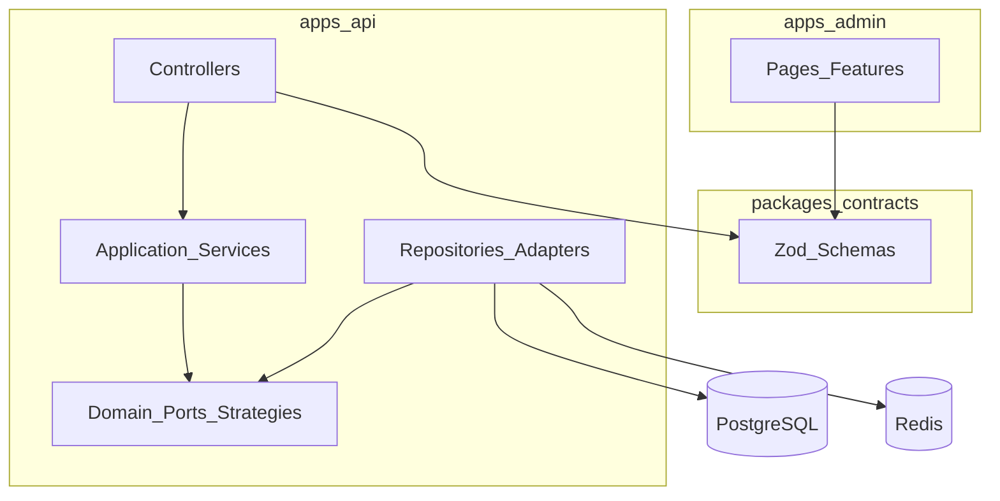

**硬性规则：**

- Controller 只做入参校验、鉴权声明、调用 Application Service，禁止直访 Prisma。
- Application Service 依赖 Domain Port（接口），由 Nest DI 注入 Infrastructure 实现。
- `domain/` 不得 import `@nestjs/*`、`@prisma/client`。
- 前后端共享字段与枚举以 `packages/contracts` 为唯一真相源。

### 1.3 Nest 模块装配示意

```text
AppModule
  ├─ ConfigModule / LoggerModule / BullModule / PrismaModule
  ├─ AuthModule
  ├─ DashboardModule
  ├─ OrganizationModule
  ├─ UserModule
  ├─ MembershipModule
  └─ RbacModule
```

各业务 Module：`controllers` + `services` + `providers`（Repository 实现绑定接口 Token）。

---

## 2. 设计模式总览

| 模式 | 用途 | 关键类型 |
|---|---|---|
| Repository | 隔离 Prisma 持久化 | `IUserRepository`, `PrismaUserRepository` 等 |
| Strategy | 权益合并、密码哈希、数据范围 | `IBenefitMergeStrategy`, `IPasswordHasher`, `IDataScopeStrategy` |
| Factory | 按买方类型创建订单 | `MembershipOrderFactory` |
| Template Method | 批量导入行处理骨架 | `AbstractImportTemplate` |
| Decorator | 权限码、当前用户注入 | `@RequirePermissions`, `@CurrentUser` |
| Adapter | 支付渠道、通知通道 | `IPaymentGateway`, `INotificationPort` |
| Facade | 看板多源聚合 | `DashboardFacade` |
| Specification | 复杂列表筛选组合 | `UserListSpecification` |
| Observer / Domain Event | 支付成功开通订阅 | `OrderPaidEvent` + Handlers |
| DI / IoC | 面向接口注入 | Nest `providers` + injection token |

---

## 3. 枚举与公共约定

### 3.1 Prisma / 领域枚举

| 枚举名 | 值 | 含义 |
|---|---|---|
| `CommonStatus` | `active`, `disabled` | 通用启用/禁用 |
| `UserStatus` | `active`, `disabled`, `pending` | 用户状态 |
| `RoleType` | `system`, `custom` | 系统预置 / 自定义角色 |
| `PermissionType` | `menu`, `button`, `data`, `export` | 权限类型 |
| `DataScopeType` | `all`, `org`, `dept`, `dept_and_child`, `self`, `custom` | 数据范围 |
| `MembershipScope` | `user`, `org`, `both` | 等级适用买方 |
| `BenefitValueType` | `int`, `bool`, `bytes` | 权益值类型 |
| `SubscriptionStatus` | `active`, `expired`, `cancelled`, `pending` | 订阅状态 |
| `BuyerType` | `user`, `org` | 订单买方类型 |
| `OrderStatus` | `pending`, `paid`, `cancelled`, `refunded`, `failed` | 订单状态 |
| `PaymentStatus` | `pending`, `success`, `failed`, `refunded` | 支付状态 |
| `InvoiceStatus` | `pending`, `issued`, `rejected` | 发票状态 |
| `SubscriptionOwnerType` | `user`, `org` | 续费提醒所属订阅类型 |
| `ImportJobStatus` | `queued`, `running`, `succeeded`, `failed`, `partial` | 导入任务状态 |
| `AuditAction` | `create`, `update`, `delete`, `disable`, `reset_password`, `assign`, `login` 等 | 审计动作 |

### 3.2 公共字段约定

所有业务主表建议包含：

| 字段 | 类型 | 说明 |
|---|---|---|
| `id` | `String @id @default(cuid())` | 主键 |
| `createdAt` | `DateTime @default(now())` | 创建时间 |
| `updatedAt` | `DateTime @updatedAt` | 更新时间 |
| `deletedAt` | `DateTime?` | 软删除时间，非空表示已删除 |

金额字段使用 `Decimal(12, 2)`；容量类使用 `BigInt`；JSON 配置使用 `Json`。

### 3.3 预置数据

**角色码：** `researcher` / `data_admin` / `content_admin` / `platform_admin`

**权益码（一期）：**

| code | value_type | 说明 |
|---|---|---|
| `search_quota` | int | 搜索次数上限（周期内） |
| `export_quota` | int | 导出次数上限 |
| `max_agents` | int | 可创建 Agent 数量上限 |
| `storage_bytes` | bytes | 存储容量上限 |

**免费档默认权益：** 各指标为平台配置的最低档（实现时写入 seed），无有效订阅时回落至此。

---

## 4. 表结构与 ER

### 4.1 ER 总图

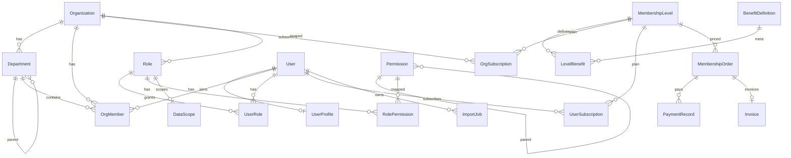

### 4.2 组织与用户

#### 4.2.1 `organizations`（组织 / 租户）

| 字段 | 类型 | 约束 | 注释 |
|---|---|---|---|
| id | String | PK | 组织主键 |
| name | String(128) | 非空 | 组织名称 |
| code | String(64) | 唯一、非空 | 组织编码，全局唯一 |
| status | CommonStatus | 默认 active | 启用状态 |
| parentId | String? | FK → organizations.id | 上级组织，支持集团树；一期可空 |
| contactName | String(64)? | | 联系人 |
| contactPhone | String(32)? | | 联系电话 |
| remark | String(512)? | | 备注 |
| createdAt / updatedAt / deletedAt | DateTime | | 审计与软删除 |

索引：`@@unique([code])`；`@@index([parentId])`；`@@index([status])`

#### 4.2.2 `departments`（部门树）

| 字段 | 类型 | 约束 | 注释 |
|---|---|---|---|
| id | String | PK | 部门主键 |
| orgId | String | FK → organizations.id | 所属组织 |
| parentId | String? | FK → departments.id | 上级部门 |
| name | String(128) | 非空 | 部门名称 |
| sort | Int | 默认 0 | 同级排序 |
| status | CommonStatus | 默认 active | 启用状态 |
| createdAt / updatedAt / deletedAt | DateTime | | |

索引：`@@index([orgId, parentId])`；`@@unique([orgId, name, parentId])`（实现时注意 NULL parent 语义，可用应用层校验）

#### 4.2.3 `users`（平台账号）

| 字段 | 类型 | 约束 | 注释 |
|---|---|---|---|
| id | String | PK | 用户主键 |
| username | String(64) | 唯一 | 登录名 |
| email | String(128)? | 唯一（可空唯一） | 邮箱 |
| phone | String(32)? | 唯一（可空唯一） | 手机号 |
| passwordHash | String(255) | 非空 | 密码哈希，禁止存明文 |
| status | UserStatus | 默认 pending | 账号状态 |
| lastLoginAt | DateTime? | | 最近登录时间 |
| createdAt / updatedAt / deletedAt | DateTime | | |

索引：`@@unique([username])`；`@@index([status])`

#### 4.2.4 `user_profiles`（用户扩展资料）

| 字段 | 类型 | 约束 | 注释 |
|---|---|---|---|
| userId | String | PK, FK → users.id | 一对一用户 |
| displayName | String(64)? | | 显示名 |
| avatarUrl | String(512)? | | 头像 URL（MinIO） |
| remark | String(512)? | | 备注 |
| createdAt / updatedAt | DateTime | | |

#### 4.2.5 `org_members`（组织成员）

| 字段 | 类型 | 约束 | 注释 |
|---|---|---|---|
| id | String | PK | 成员关系主键 |
| orgId | String | FK | 组织 |
| userId | String | FK | 用户 |
| deptId | String? | FK → departments.id | 所属部门 |
| title | String(64)? | | 职务 |
| status | CommonStatus | 默认 active | 成员状态 |
| joinedAt | DateTime | 默认 now | 加入时间 |
| createdAt / updatedAt / deletedAt | DateTime | | |

约束：`@@unique([orgId, userId])`；索引 `@@index([deptId])`；`@@index([userId])`

### 4.3 RBAC

#### 4.3.1 `roles`

| 字段 | 类型 | 约束 | 注释 |
|---|---|---|---|
| id | String | PK | 角色主键 |
| code | String(64) | 非空 | 角色编码；系统角色全局唯一 |
| name | String(64) | 非空 | 角色名称 |
| type | RoleType | 默认 custom | 系统 / 自定义 |
| orgId | String? | FK | 组织级自定义角色作用域；系统角色为空 |
| status | CommonStatus | 默认 active | 状态 |
| description | String(256)? | | 描述 |
| createdAt / updatedAt / deletedAt | DateTime | | |

约束：`@@unique([code, orgId])`（系统角色 orgId 固定 null 时需应用层保证唯一）

#### 4.3.2 `permissions`

| 字段 | 类型 | 约束 | 注释 |
|---|---|---|---|
| id | String | PK | 权限主键 |
| code | String(128) | 唯一 | 权限码，如 `user:create`、`menu:org` |
| name | String(128) | 非空 | 显示名 |
| type | PermissionType | 非空 | menu / button / data / export |
| parentId | String? | FK → permissions.id | 菜单树父节点 |
| path | String(256)? | | 前端路由 path（menu 用） |
| resource | String(128)? | | 资源标识（data/export 用） |
| sort | Int | 默认 0 | 排序 |
| status | CommonStatus | 默认 active | 状态 |
| createdAt / updatedAt / deletedAt | DateTime | | |

#### 4.3.3 `role_permissions`

| 字段 | 类型 | 约束 | 注释 |
|---|---|---|---|
| roleId | String | PK 复合, FK | 角色 |
| permissionId | String | PK 复合, FK | 权限 |
| createdAt | DateTime | | 绑定时间 |

#### 4.3.4 `user_roles`

| 字段 | 类型 | 约束 | 注释 |
|---|---|---|---|
| id | String | PK | 绑定主键 |
| userId | String | FK | 用户 |
| roleId | String | FK | 角色 |
| orgId | String? | FK | 角色在该组织下生效；平台级角色可空 |
| createdAt | DateTime | | |

约束：`@@unique([userId, roleId, orgId])`

#### 4.3.5 `data_scopes`

| 字段 | 类型 | 约束 | 注释 |
|---|---|---|---|
| id | String | PK | 数据范围规则主键 |
| roleId | String | 唯一 FK | 一个角色一条主规则（一期） |
| scopeType | DataScopeType | 非空 | 范围类型 |
| customDeptIds | Json? | | scopeType=custom 时的部门 ID 列表 |
| createdAt / updatedAt | DateTime | | |

### 4.4 会员（双层订阅 + 权益）

#### 4.4.1 `membership_levels`

| 字段 | 类型 | 约束 | 注释 |
|---|---|---|---|
| id | String | PK | 等级主键 |
| code | String(64) | 唯一 | 等级编码 |
| name | String(64) | 非空 | 等级名称 |
| scope | MembershipScope | 非空 | 适用 user / org / both |
| price | Decimal(12,2) | 非空 | 标价 |
| durationDays | Int | 非空 | 有效天数 |
| status | CommonStatus | 默认 active | 是否可售 |
| sort | Int | 默认 0 | 展示排序 |
| description | String(512)? | | 说明 |
| createdAt / updatedAt / deletedAt | DateTime | | |

#### 4.4.2 `benefit_definitions`

| 字段 | 类型 | 约束 | 注释 |
|---|---|---|---|
| id | String | PK | 权益定义主键 |
| code | String(64) | 唯一 | 权益码 |
| name | String(64) | 非空 | 显示名 |
| valueType | BenefitValueType | 非空 | 值类型 |
| unit | String(32)? | | 单位文案，如 次/月、GB |
| description | String(256)? | | 说明 |
| createdAt / updatedAt | DateTime | | |

#### 4.4.3 `level_benefits`

| 字段 | 类型 | 约束 | 注释 |
|---|---|---|---|
| id | String | PK | 关联主键 |
| levelId | String | FK | 等级 |
| benefitCode | String | FK → benefit_definitions.code | 权益码 |
| valueJson | Json | 非空 | 规范化值，如 `{"n":100}` / `{"enabled":true}` / `{"bytes":1073741824}` |
| createdAt / updatedAt | DateTime | | |

约束：`@@unique([levelId, benefitCode])`

#### 4.4.4 `org_subscriptions`

| 字段 | 类型 | 约束 | 注释 |
|---|---|---|---|
| id | String | PK | 组织订阅主键 |
| orgId | String | FK | 组织 |
| levelId | String | FK | 等级 |
| status | SubscriptionStatus | 非空 | 状态 |
| startAt | DateTime | 非空 | 生效开始 |
| endAt | DateTime | 非空 | 到期时间 |
| autoRenew | Boolean | 默认 false | 是否自动续费 |
| createdAt / updatedAt / deletedAt | DateTime | | |

索引：`@@index([orgId, status, endAt])`

#### 4.4.5 `user_subscriptions`

字段同组织订阅，将 `orgId` 换为 `userId`。  
索引：`@@index([userId, status, endAt])`

#### 4.4.6 `membership_orders`

| 字段 | 类型 | 约束 | 注释 |
|---|---|---|---|
| id | String | PK | 订单主键 |
| orderNo | String(64) | 唯一 | 业务订单号 |
| buyerType | BuyerType | 非空 | user / org |
| buyerId | String | 非空 | 买方 ID（用户或组织） |
| levelId | String | FK | 购买等级 |
| amount | Decimal(12,2) | 非空 | 应付金额 |
| status | OrderStatus | 默认 pending | 订单状态 |
| paidAt | DateTime? | | 支付完成时间 |
| createdBy | String? | | 下单操作人（管理员代下单） |
| remark | String(256)? | | 备注 |
| createdAt / updatedAt / deletedAt | DateTime | | |

索引：`@@index([buyerType, buyerId])`；`@@index([status, createdAt])`

#### 4.4.7 `payment_records`

| 字段 | 类型 | 约束 | 注释 |
|---|---|---|---|
| id | String | PK | 支付流水主键 |
| orderId | String | FK | 所属订单 |
| channel | String(32) | 非空 | 支付渠道编码，如 mock / wechat / alipay |
| tradeNo | String(128)? | 唯一可空 | 渠道交易号 |
| amount | Decimal(12,2) | 非空 | 支付金额 |
| status | PaymentStatus | 非空 | 支付状态 |
| paidAt | DateTime? | | 成功时间 |
| rawPayload | Json? | | 渠道回调原文（脱敏后） |
| createdAt / updatedAt | DateTime | | |

#### 4.4.8 `invoices`

| 字段 | 类型 | 约束 | 注释 |
|---|---|---|---|
| id | String | PK | 发票主键 |
| orderId | String | 唯一 FK | 一单一票（一期） |
| title | String(128) | 非空 | 发票抬头 |
| taxNo | String(64)? | | 税号 |
| status | InvoiceStatus | 默认 pending | 开票状态 |
| issuedAt | DateTime? | | 开票时间 |
| createdAt / updatedAt | DateTime | | |

#### 4.4.9 `renewal_reminders`

| 字段 | 类型 | 约束 | 注释 |
|---|---|---|---|
| id | String | PK | 提醒主键 |
| subscriptionType | SubscriptionOwnerType | 非空 | user / org |
| subscriptionId | String | 非空 | 订阅 ID |
| remindAt | DateTime | 非空 | 计划提醒时间 |
| sentAt | DateTime? | | 实际发送时间 |
| channel | String(32) | 非空 | email / sms / inbox |
| createdAt / updatedAt | DateTime | | |

索引：`@@index([remindAt, sentAt])`；`@@unique([subscriptionType, subscriptionId, remindAt, channel])`

### 4.5 看板与支撑

#### 4.5.1 `dashboard_daily_stats`

| 字段 | 类型 | 约束 | 注释 |
|---|---|---|---|
| id | String | PK | 统计主键 |
| statDate | DateTime @db.Date | 唯一 | 统计日 |
| userTotal | Int | 默认 0 | 用户总数快照 |
| searchCount | Int | 默认 0 | 当日搜索量 |
| dataVolume | BigInt | 默认 0 | 数据总量快照（条或字节，实现时在文档标注单位） |
| agentTaskCount | Int | 默认 0 | 当日 Agent 任务数 |
| metrics | Json | 默认 {} | 扩展指标（二期不改表） |
| createdAt / updatedAt | DateTime | | |

#### 4.5.2 `audit_logs`

| 字段 | 类型 | 约束 | 注释 |
|---|---|---|---|
| id | String | PK | 审计主键 |
| actorId | String? | | 操作人用户 ID |
| action | String(64) | 非空 | 动作码 |
| resourceType | String(64) | 非空 | 资源类型 |
| resourceId | String? | | 资源 ID |
| detail | Json? | | 变更详情（脱敏） |
| ip | String(64)? | | 来源 IP |
| createdAt | DateTime | | 发生时间 |

索引：`@@index([actorId, createdAt])`；`@@index([resourceType, resourceId])`

#### 4.5.3 `import_jobs`

| 字段 | 类型 | 约束 | 注释 |
|---|---|---|---|
| id | String | PK | 导入任务主键 |
| type | String(32) | 非空 | 如 `user_batch` |
| status | ImportJobStatus | 默认 queued | 任务状态 |
| fileKey | String(512) | 非空 | MinIO 对象键 |
| totalRows | Int | 默认 0 | 总行数 |
| successRows | Int | 默认 0 | 成功行数 |
| failedRows | Int | 默认 0 | 失败行数 |
| errorReportKey | String(512)? | | 失败报告文件键 |
| createdBy | String | 非空 | 发起人 |
| createdAt / updatedAt | DateTime | | |

---

## 5. 功能流程图

### 5.1 运营看板 — 平台总览

**目标：** 展示用户总数、搜索量、数据总量、Agent 任务数。

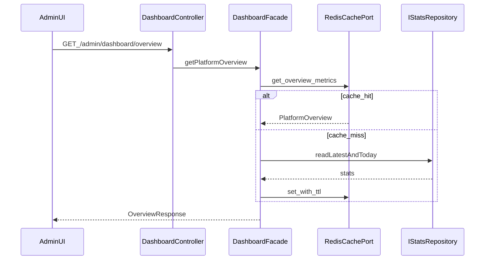

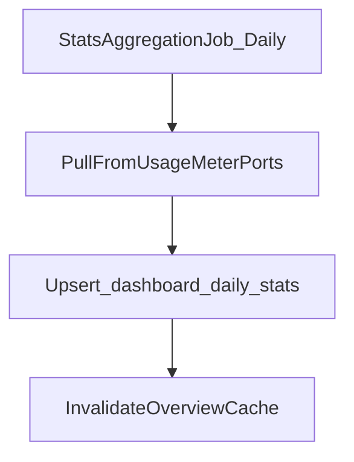

### 5.2 组织管理

**目标：** 组织树、部门管理、成员分配。

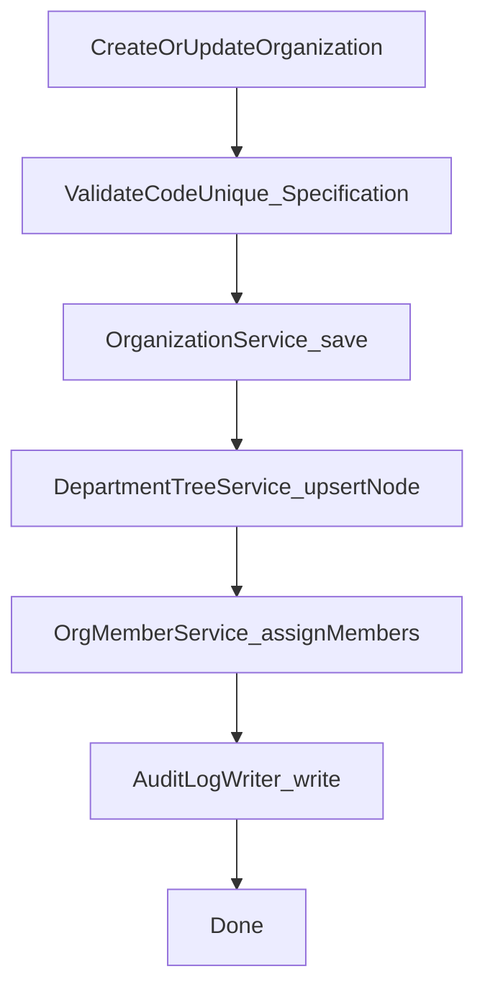

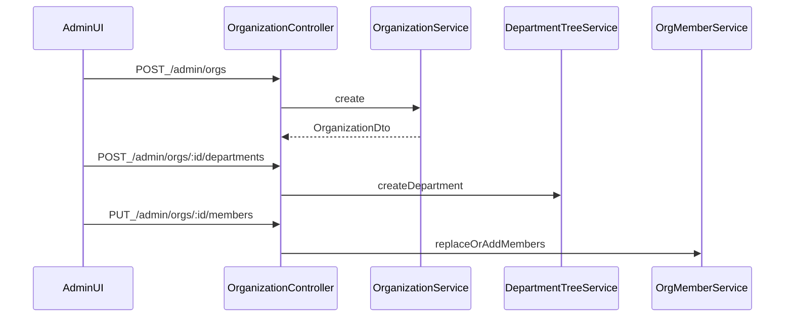

### 5.3 用户账号管理

**目标：** 新增、批量导入、编辑、禁用、重置密码。

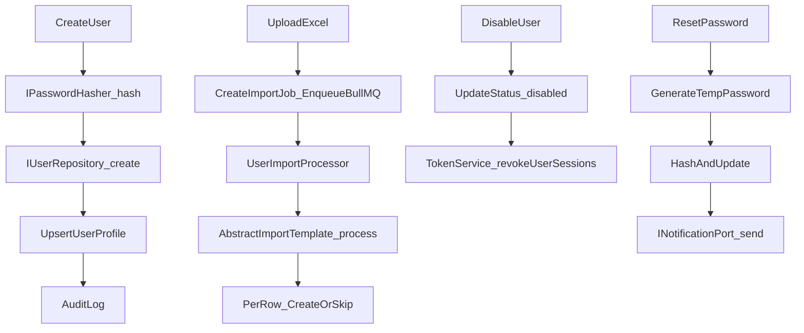

### 5.4 会员等级与权益配置

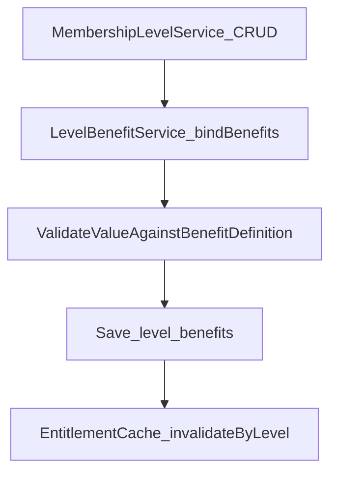

### 5.5 会员订购 / 支付 / 开通（双层）

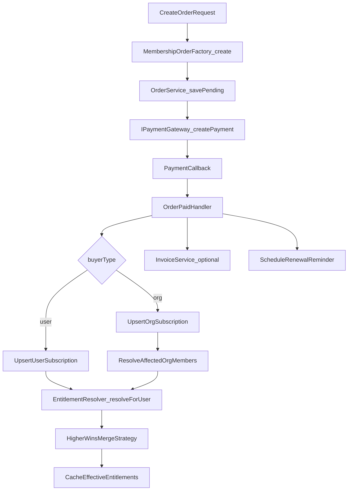

**权益合并规则（HigherWins）：**

| valueType | 合并规则 |
|---|---|
| int / bytes | 取 max |
| bool | 取 OR（任一为 true 则为 true） |
| 订阅时效 | 仅纳入 `status=active` 且 `now ∈ [startAt, endAt]` 的订阅 |

用户有效权益 = `merge(个人有效订阅权益, 其所属全部有效组织订阅权益..., 免费档默认权益)`。

### 5.6 角色权限与鉴权

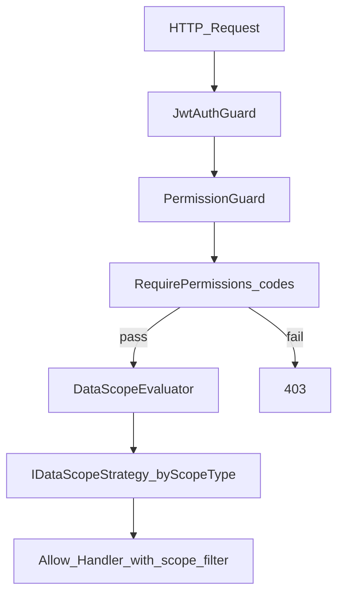

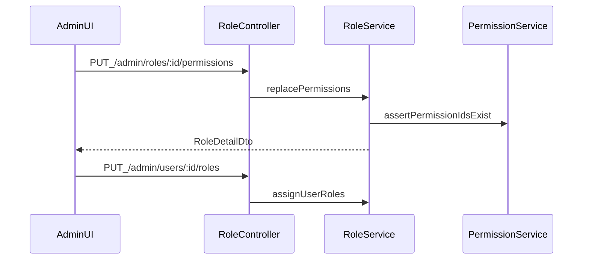

### 5.7 管理端登录

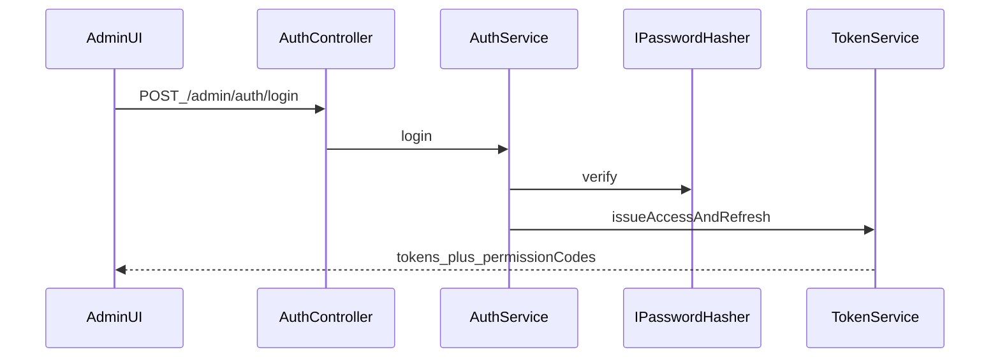

---

## 6. 类 / 方法 / 属性规格（含注释）

> 实现阶段所有类、方法、属性必须带 JSDoc/`/** */` 中文注释；以下为规格正文，字段含义即注释内容。

### 6.1 公共基座 `common/` + `domain/ports`

#### Class: `PageQuery`

**职责:** 管理端列表分页查询基类。

| 成员 | 类型 | 注释 |
|---|---|---|
| `page` | `number` | 页码，从 1 开始 |
| `pageSize` | `number` | 每页条数，默认 20，上限 100 |
| `keyword?` | `string` | 通用关键字 |

| 方法 | 签名 | 注释 |
|---|---|---|
| `toSkipTake` | `(): { skip: number; take: number }` | 转换为 Prisma skip/take |

#### Class: `PageResult<T>`

**职责:** 分页结果包装。

| 成员 | 类型 | 注释 |
|---|---|---|
| `items` | `T[]` | 当前页数据 |
| `total` | `number` | 总条数 |
| `page` | `number` | 当前页 |
| `pageSize` | `number` | 页大小 |

#### Interface: `IRepository<TId, TEntity>`

**职责:** 通用仓储端口，隔离持久化细节。

| 方法 | 签名 | 注释 |
|---|---|---|
| `findById` | `(id: TId) => Promise<TEntity \| null>` | 按主键查询，忽略已软删 |
| `save` | `(entity: TEntity) => Promise<TEntity>` | 新增或更新 |
| `softDelete` | `(id: TId) => Promise<void>` | 软删除 |

#### Class: `AuditLogWriter`

**职责:** 异步写入管理操作审计。

| 属性 | 类型 | 注释 |
|---|---|---|
| `auditRepo` | `IAuditLogRepository` | 审计仓储端口 |

| 方法 | 签名 | 注释 |
|---|---|---|
| `write` | `(entry: AuditEntry) => Promise<void>` | 记录操作人、动作、资源与脱敏详情 |

#### Class: `AuditEntry`（值对象）

| 属性 | 类型 | 注释 |
|---|---|---|
| `actorId` | `string \| null` | 操作人 ID |
| `action` | `string` | 动作码 |
| `resourceType` | `string` | 资源类型 |
| `resourceId` | `string \| null` | 资源 ID |
| `detail` | `Record<string, unknown> \| null` | 变更详情 |
| `ip` | `string \| null` | 来源 IP |

#### Decorator: `RequirePermissions`

**职责:** 声明接口所需权限码（Decorator 模式）。

| 方法 | 签名 | 注释 |
|---|---|---|
| `RequirePermissions` | `(...codes: string[]) => MethodDecorator` | 将权限码元数据挂到 handler，供 Guard 读取 |

#### Decorator: `CurrentUser`

**职责:** 注入当前登录用户上下文。

| 方法 | 签名 | 注释 |
|---|---|---|
| `CurrentUser` | `() => ParameterDecorator` | 从 request 提取 `AuthUserContext` |

#### Class: `AuthUserContext`

| 属性 | 类型 | 注释 |
|---|---|---|
| `userId` | `string` | 当前用户 ID |
| `username` | `string` | 登录名 |
| `permissionCodes` | `string[]` | 已解析权限码集合 |
| `roleIds` | `string[]` | 角色 ID 列表 |
| `orgIds` | `string[]` | 所属组织 ID 列表 |

#### Class: `PermissionGuard`

**职责:** 校验菜单/按钮权限码。

| 属性 | 类型 | 注释 |
|---|---|---|
| `reflector` | `Reflector` | 读取 handler 元数据 |

| 方法 | 签名 | 注释 |
|---|---|---|
| `canActivate` | `(context: ExecutionContext) => boolean \| Promise<boolean>` | 无权限码要求则放行；否则要求 codes 全匹配或配置为任一匹配 |

#### Class: `BusinessException`

**职责:** 可预期业务异常。

| 属性 | 类型 | 注释 |
|---|---|---|
| `code` | `string` | 稳定错误码 |
| `message` | `string` | 面向客户端的说明 |
| `httpStatus` | `number` | HTTP 状态 |

---

### 6.2 领域策略 `domain/strategies`

#### Interface: `IPasswordHasher`

**职责:** 密码哈希策略端口（Strategy）。

| 方法 | 签名 | 注释 |
|---|---|---|
| `hash` | `(plain: string) => Promise<string>` | 对明文密码做单向哈希 |
| `verify` | `(plain: string, hash: string) => Promise<boolean>` | 校验明文与哈希是否匹配 |

#### Class: `BcryptPasswordHasher` implements `IPasswordHasher`

**职责:** bcrypt 实现。

| 属性 | 类型 | 注释 |
|---|---|---|
| `rounds` | `number` | 成本因子，来自配置 |

| 方法 | 签名 | 注释 |
|---|---|---|
| `hash` | `(plain: string) => Promise<string>` | 生成哈希 |
| `verify` | `(plain: string, hash: string) => Promise<boolean>` | 验密 |

#### Interface: `IBenefitMergeStrategy`

**职责:** 多来源权益合并策略端口。

| 方法 | 签名 | 注释 |
|---|---|---|
| `merge` | `(sources: BenefitBundle[]) => BenefitBundle` | 将多组权益合并为最终有效权益 |

#### Class: `BenefitBundle`（值对象）

| 属性 | 类型 | 注释 |
|---|---|---|
| `sourceType` | `'user' \| 'org' \| 'default'` | 来源类型 |
| `sourceId` | `string \| null` | 来源订阅或默认档 ID |
| `values` | `Map<string, BenefitValue>` | 权益码到值 |

#### Class: `BenefitValue`（值对象）

| 属性 | 类型 | 注释 |
|---|---|---|
| `code` | `string` | 权益码 |
| `valueType` | `BenefitValueType` | 值类型 |
| `raw` | `unknown` | 原始 JSON 值 |

| 方法 | 签名 | 注释 |
|---|---|---|
| `asNumber` | `(): number` | 以数值读取（int/bytes） |
| `asBoolean` | `(): boolean` | 以布尔读取 |

#### Class: `HigherWinsMergeStrategy` implements `IBenefitMergeStrategy`

**职责:** 取更高额度合并（一期默认）。

| 方法 | 签名 | 注释 |
|---|---|---|
| `merge` | `(sources: BenefitBundle[]) => BenefitBundle` | int/bytes 取 max，bool 取 OR |

#### Interface: `IDataScopeStrategy`

**职责:** 按范围类型生成查询约束。

| 方法 | 签名 | 注释 |
|---|---|---|
| `supports` | `(type: DataScopeType) => boolean` | 是否支持该范围类型 |
| `buildFilter` | `(ctx: DataScopeContext) => DataScopeFilter` | 生成仓储可消费的过滤条件 |

#### Class: `DataScopeContext`

| 属性 | 类型 | 注释 |
|---|---|---|
| `userId` | `string` | 当前用户 |
| `orgIds` | `string[]` | 所属组织 |
| `deptIds` | `string[]` | 所属部门 |
| `customDeptIds` | `string[]` | 自定义部门列表 |

#### Class: `DataScopeFilter`

| 属性 | 类型 | 注释 |
|---|---|---|
| `orgIds?` | `string[]` | 限制组织 |
| `deptIds?` | `string[]` | 限制部门 |
| `onlySelf?` | `boolean` | 仅本人 |
| `unrestricted?` | `boolean` | 全部数据 |

#### Class: `AllDataScopeStrategy` / `OrgDataScopeStrategy` / `DeptDataScopeStrategy` / `DeptAndChildDataScopeStrategy` / `SelfDataScopeStrategy` / `CustomDataScopeStrategy`

**职责:** 各 `DataScopeType` 的具体策略实现；均实现 `IDataScopeStrategy`，方法注释同接口，类注释标明对应枚举值。

#### Class: `DataScopeEvaluator`

**职责:** 根据角色数据范围选择策略并求交/求并（一期取最宽松：任一角色 unrestricted 则放开）。

| 属性 | 类型 | 注释 |
|---|---|---|
| `strategies` | `IDataScopeStrategy[]` | 已注册策略列表 |

| 方法 | 签名 | 注释 |
|---|---|---|
| `evaluate` | `(user: AuthUserContext, roleScopes: DataScopeType[]) => DataScopeFilter` | 计算最终数据过滤条件 |

---

### 6.3 Auth 模块

#### Class: `AuthController`

**职责:** 管理端认证 HTTP 入口。

| 方法 | 签名 | 注释 |
|---|---|---|
| `login` | `(dto: LoginRequest) => Promise<LoginResponse>` | 账号密码登录，返回令牌与权限码 |
| `logout` | `(user: AuthUserContext) => Promise<void>` | 注销并失效刷新令牌 |
| `refresh` | `(dto: RefreshRequest) => Promise<TokenPair>` | 刷新访问令牌 |
| `me` | `(user: AuthUserContext) => Promise<ProfileResponse>` | 当前用户资料与权限 |

#### Class: `AuthService`

**职责:** 认证应用服务。

| 属性 | 类型 | 注释 |
|---|---|---|
| `userRepo` | `IUserRepository` | 用户仓储 |
| `passwordHasher` | `IPasswordHasher` | 密码策略 |
| `tokenService` | `TokenService` | 令牌签发与吊销 |
| `permissionService` | `PermissionService` | 权限码解析 |
| `auditLogWriter` | `AuditLogWriter` | 登录审计 |

| 方法 | 签名 | 注释 |
|---|---|---|
| `login` | `(command: LoginCommand) => Promise<LoginResult>` | 校验状态与密码，签发令牌 |
| `logout` | `(userId: string, refreshToken?: string) => Promise<void>` | 吊销会话 |
| `refresh` | `(refreshToken: string) => Promise<TokenPair>` | 校验刷新令牌并轮换 |
| `getProfile` | `(userId: string) => Promise<ProfileResult>` | 聚合资料、角色、权限 |

#### Class: `TokenService`

**职责:** JWT 访问令牌与刷新令牌管理。

| 属性 | 类型 | 注释 |
|---|---|---|
| `jwtSecret` | `string` | 签名密钥 |
| `accessTtlSec` | `number` | 访问令牌 TTL |
| `refreshTtlSec` | `number` | 刷新令牌 TTL |
| `redis` | `IRedisPort` | 会话黑名单 / 刷新令牌存储 |

| 方法 | 签名 | 注释 |
|---|---|---|
| `issueAccessAndRefresh` | `(userId: string, claims: TokenClaims) => Promise<TokenPair>` | 签发双令牌并持久化刷新令牌 |
| `verifyAccess` | `(token: string) => Promise<TokenClaims>` | 校验访问令牌 |
| `rotateRefresh` | `(refreshToken: string) => Promise<TokenPair>` | 轮换刷新令牌 |
| `revokeUserSessions` | `(userId: string) => Promise<void>` | 吊销用户全部会话（禁用/重置密码时） |

#### Class: `TokenPair` / `TokenClaims`

| 类型 | 属性 | 注释 |
|---|---|---|
| `TokenPair` | `accessToken`, `refreshToken`, `expiresIn` | 令牌对与过期秒数 |
| `TokenClaims` | `sub`, `username`, `roleIds` | JWT 声明 |

#### Class: `JwtStrategy`

**职责:** Passport JWT 策略，填充 `AuthUserContext`。

| 属性 | 类型 | 注释 |
|---|---|---|
| `tokenService` | `TokenService` | 令牌校验 |
| `permissionService` | `PermissionService` | 加载权限码 |

| 方法 | 签名 | 注释 |
|---|---|---|
| `validate` | `(payload: TokenClaims) => Promise<AuthUserContext>` | 将 JWT payload 转为请求用户上下文 |

---

### 6.4 Organization 模块

#### Class: `OrganizationController`

| 方法 | 签名 | 注释 |
|---|---|---|
| `create` | `(dto: CreateOrgRequest) => Promise<OrgDto>` | 创建组织 |
| `update` | `(id: string, dto: UpdateOrgRequest) => Promise<OrgDto>` | 更新组织 |
| `tree` | `() => Promise<OrgTreeNode[]>` | 组织树（含 parent） |
| `detail` | `(id: string) => Promise<OrgDetailDto>` | 组织详情 |
| `disable` | `(id: string) => Promise<void>` | 禁用组织 |

#### Class: `OrganizationService`

| 属性 | 类型 | 注释 |
|---|---|---|
| `orgRepo` | `IOrganizationRepository` | 组织仓储 |
| `auditLogWriter` | `AuditLogWriter` | 审计 |

| 方法 | 签名 | 注释 |
|---|---|---|
| `create` | `(cmd: CreateOrgCommand) => Promise<Organization>` | 校验 code 唯一后创建 |
| `update` | `(id: string, cmd: UpdateOrgCommand) => Promise<Organization>` | 更新基础信息 |
| `getTree` | `() => Promise<OrgTreeNode[]>` | 构建组织树 |
| `disable` | `(id: string) => Promise<void>` | 禁用并写审计 |

#### Class: `DepartmentTreeService`

| 属性 | 类型 | 注释 |
|---|---|---|
| `deptRepo` | `IDepartmentRepository` | 部门仓储 |

| 方法 | 签名 | 注释 |
|---|---|---|
| `createDepartment` | `(orgId: string, cmd: CreateDeptCommand) => Promise<Department>` | 在组织下创建部门节点 |
| `moveDepartment` | `(deptId: string, newParentId: string \| null) => Promise<void>` | 移动节点，校验无环 |
| `getTree` | `(orgId: string) => Promise<DeptTreeNode[]>` | 返回部门树 |
| `assertNoCycle` | `(deptId: string, newParentId: string \| null) => Promise<void>` | 防止部门树成环 |

#### Class: `OrgMemberService`

| 属性 | 类型 | 注释 |
|---|---|---|
| `memberRepo` | `IOrgMemberRepository` | 成员仓储 |
| `userRepo` | `IUserRepository` | 用户存在性校验 |

| 方法 | 签名 | 注释 |
|---|---|---|
| `assignMembers` | `(orgId: string, items: AssignMemberItem[]) => Promise<void>` | 批量加入组织并指定部门 |
| `removeMember` | `(orgId: string, userId: string) => Promise<void>` | 移除成员（软删关系） |
| `listMembers` | `(orgId: string, query: PageQuery) => Promise<PageResult<OrgMemberDto>>` | 分页成员列表 |
| `changeDepartment` | `(orgId: string, userId: string, deptId: string \| null) => Promise<void>` | 调整成员部门 |

#### Interface: `IOrganizationRepository` / `IDepartmentRepository` / `IOrgMemberRepository`

**职责:** 组织域仓储端口；除 `IRepository` 基方法外扩展：

| 接口 | 额外方法 | 注释 |
|---|---|---|
| `IOrganizationRepository` | `findByCode`, `listAllActive` | 编码查重；拉树数据 |
| `IDepartmentRepository` | `listByOrg`, `findChildren` | 按组织列出；查子节点 |
| `IOrgMemberRepository` | `findByOrgAndUser`, `listByOrg`, `listOrgIdsByUser` | 关系查询；用户所属组织 |

#### Class: `PrismaOrganizationRepository` 等

**职责:** Prisma 适配实现对应接口；属性仅 `prisma: PrismaService`；方法注释与接口一致，类注释标明「Infrastructure Adapter」。

---

### 6.5 User 模块

#### Class: `UserController`

| 方法 | 签名 | 注释 |
|---|---|---|
| `create` | `(dto: CreateUserRequest) => Promise<UserDto>` | 新增用户 |
| `update` | `(id: string, dto: UpdateUserRequest) => Promise<UserDto>` | 编辑资料 |
| `page` | `(query: UserPageQuery) => Promise<PageResult<UserDto>>` | 分页查询 |
| `disable` | `(id: string) => Promise<void>` | 禁用账号 |
| `enable` | `(id: string) => Promise<void>` | 启用账号 |
| `resetPassword` | `(id: string) => Promise<{ tempPassword?: string }>` | 重置密码 |
| `importUsers` | `(file: UploadedFile) => Promise<{ jobId: string }>` | 批量导入 |

#### Class: `UserService`

| 属性 | 类型 | 注释 |
|---|---|---|
| `userRepo` | `IUserRepository` | 用户仓储 |
| `passwordHasher` | `IPasswordHasher` | 密码哈希 |
| `tokenService` | `TokenService` | 会话吊销 |
| `notificationPort` | `INotificationPort` | 通知端口 |
| `auditLogWriter` | `AuditLogWriter` | 审计 |
| `listSpecBuilder` | `UserListSpecification` | 列表条件组装 |

| 方法 | 签名 | 注释 |
|---|---|---|
| `create` | `(cmd: CreateUserCommand) => Promise<User>` | 创建用户并写入 profile |
| `update` | `(id: string, cmd: UpdateUserCommand) => Promise<User>` | 更新可编辑字段 |
| `page` | `(query: UserPageQuery, scope: DataScopeFilter) => Promise<PageResult<User>>` | 带数据范围的分页 |
| `disable` | `(id: string) => Promise<void>` | 禁用并吊销会话 |
| `enable` | `(id: string) => Promise<void>` | 启用账号 |
| `resetPassword` | `(id: string) => Promise<ResetPasswordResult>` | 生成临时密码、哈希落库、通知用户 |

#### Class: `UserListSpecification`

**职责:** Specification 模式组装动态查询。

| 方法 | 签名 | 注释 |
|---|---|---|
| `fromQuery` | `(query: UserPageQuery, scope: DataScopeFilter) => UserWhere` | 将查询 DTO 与数据范围转为 where 条件 |

#### Class: `PasswordResetService`

| 属性 | 类型 | 注释 |
|---|---|---|
| `userRepo` | `IUserRepository` | 用户仓储 |
| `passwordHasher` | `IPasswordHasher` | 哈希 |
| `notificationPort` | `INotificationPort` | 发送临时密码 |
| `tokenService` | `TokenService` | 吊销旧会话 |

| 方法 | 签名 | 注释 |
|---|---|---|
| `reset` | `(userId: string) => Promise<ResetPasswordResult>` | 执行重置流程 |
| `generateTempPassword` | `() => string` | 生成符合策略的临时口令 |

#### Class: `UserImportService` extends `AbstractImportTemplate<UserImportRow>`

| 属性 | 类型 | 注释 |
|---|---|---|
| `userService` | `UserService` | 复用创建逻辑 |
| `importJobRepo` | `IImportJobRepository` | 任务状态 |
| `storage` | `IObjectStoragePort` | 读取 Excel / 写错误报告 |

| 方法 | 签名 | 注释 |
|---|---|---|
| `enqueue` | `(fileKey: string, operatorId: string) => Promise<string>` | 创建任务并投递队列，返回 jobId |
| `parseRow` | `(raw: Record<string, string>) => UserImportRow` | 模板方法：解析一行 |
| `validateRow` | `(row: UserImportRow) => void` | 模板方法：校验一行 |
| `persistRow` | `(row: UserImportRow) => Promise<void>` | 模板方法：幂等创建或跳过 |
| `onFinished` | `(summary: ImportSummary) => Promise<void>` | 模板方法：更新任务与报告 |

#### Abstract Class: `AbstractImportTemplate<TRow>`

**职责:** 批量导入模板方法骨架。

| 方法 | 签名 | 注释 |
|---|---|---|
| `process` | `(jobId: string) => Promise<ImportSummary>` | 固定流程：读 -> 逐行 parse/validate/persist -> 汇总 |
| `parseRow` | `abstract (raw) => TRow` | 子类实现解析 |
| `validateRow` | `abstract (row: TRow) => void` | 子类实现校验 |
| `persistRow` | `abstract (row: TRow) => Promise<void>` | 子类实现落库 |
| `onFinished` | `abstract (summary) => Promise<void>` | 子类实现收尾 |

#### Interface: `IUserRepository`

| 方法 | 签名 | 注释 |
|---|---|---|
| `findByUsername` | `(username: string) => Promise<User \| null>` | 登录查用户 |
| `findByEmail` | `(email: string) => Promise<User \| null>` | 邮箱查重 |
| `pageBySpec` | `(where: UserWhere, page: PageQuery) => Promise<PageResult<User>>` | 条件分页 |
| `updateStatus` | `(id: string, status: UserStatus) => Promise<void>` | 更新状态 |
| `updatePasswordHash` | `(id: string, hash: string) => Promise<void>` | 更新密码哈希 |

#### Interface: `INotificationPort`

| 方法 | 签名 | 注释 |
|---|---|---|
| `send` | `(message: NotificationMessage) => Promise<void>` | 发送通知（邮件/站内信适配） |

#### Class: `NotificationMessage`

| 属性 | 类型 | 注释 |
|---|---|---|
| `toUserId` | `string` | 接收用户 |
| `channel` | `string` | 通道 |
| `templateCode` | `string` | 模板编码 |
| `payload` | `Record<string, string>` | 模板变量 |

---

### 6.6 Membership 模块

#### Class: `MembershipLevelController`

| 方法 | 签名 | 注释 |
|---|---|---|
| `create` | `(dto) => Promise<LevelDto>` | 创建等级 |
| `update` | `(id, dto) => Promise<LevelDto>` | 更新等级 |
| `page` | `(query) => Promise<PageResult<LevelDto>>` | 等级分页 |
| `bindBenefits` | `(id, dto) => Promise<LevelDto>` | 配置等级权益 |
| `disable` | `(id) => Promise<void>` | 下架等级 |

#### Class: `MembershipLevelService`

| 属性 | 类型 | 注释 |
|---|---|---|
| `levelRepo` | `IMembershipLevelRepository` | 等级仓储 |
| `benefitDefRepo` | `IBenefitDefinitionRepository` | 权益定义仓储 |
| `levelBenefitRepo` | `ILevelBenefitRepository` | 等级权益仓储 |
| `entitlementCache` | `IEntitlementCachePort` | 权益缓存失效 |

| 方法 | 签名 | 注释 |
|---|---|---|
| `create` | `(cmd) => Promise<MembershipLevel>` | 创建可售等级 |
| `update` | `(id, cmd) => Promise<MembershipLevel>` | 更新价格/时长/范围等 |
| `bindBenefits` | `(levelId, items: BenefitBindItem[]) => Promise<void>` | 校验 valueType 后绑定权益 |
| `getWithBenefits` | `(levelId) => Promise<LevelWithBenefits>` | 详情含权益列表 |

#### Class: `OrderController`

| 方法 | 签名 | 注释 |
|---|---|---|
| `create` | `(dto: CreateOrderRequest) => Promise<OrderDto>` | 创建订单并拉起支付 |
| `page` | `(query) => Promise<PageResult<OrderDto>>` | 订单分页 |
| `detail` | `(id) => Promise<OrderDetailDto>` | 订单详情（含支付/发票） |
| `cancel` | `(id) => Promise<void>` | 取消未支付订单 |

#### Class: `OrderService`

| 属性 | 类型 | 注释 |
|---|---|---|
| `orderFactory` | `MembershipOrderFactory` | 订单工厂 |
| `orderRepo` | `IMembershipOrderRepository` | 订单仓储 |
| `paymentGateway` | `IPaymentGateway` | 支付网关端口 |
| `eventBus` | `IDomainEventBus` | 领域事件总线 |

| 方法 | 签名 | 注释 |
|---|---|---|
| `createOrder` | `(cmd: CreateOrderCommand) => Promise<CreateOrderResult>` | 工厂创建、落库、调用支付 |
| `markPaid` | `(orderNo: string, payment: PaymentSuccessInfo) => Promise<void>` | 支付成功入账并发布事件 |
| `cancel` | `(orderId: string) => Promise<void>` | 仅 pending 可取消 |
| `page` | `(query, scope) => Promise<PageResult<Order>>` | 订单列表 |

#### Class: `MembershipOrderFactory`

**职责:** Factory 模式，按买方类型创建领域订单。

| 属性 | 类型 | 注释 |
|---|---|---|
| `levelRepo` | `IMembershipLevelRepository` | 读取等级标价与 scope |
| `userRepo` | `IUserRepository` | 校验个人买方 |
| `orgRepo` | `IOrganizationRepository` | 校验组织买方 |

| 方法 | 签名 | 注释 |
|---|---|---|
| `create` | `(cmd: CreateOrderCommand) => Promise<MembershipOrder>` | 校验 buyer 与 level.scope 匹配，生成 orderNo 与金额 |

#### Interface: `IPaymentGateway`

**职责:** 支付渠道适配端口（Adapter）。

| 方法 | 签名 | 注释 |
|---|---|---|
| `createPayment` | `(order: MembershipOrder) => Promise<PaymentCreateResult>` | 创建支付意图 / 收银台信息 |
| `parseCallback` | `(raw: unknown) => Promise<PaymentSuccessInfo>` | 解析并验签回调 |

#### Class: `MockPaymentGateway` implements `IPaymentGateway`

**职责:** 一期本地/联调 Mock 支付；类注释标明可替换为微信/支付宝 Adapter。

#### Class: `PaymentService`

| 属性 | 类型 | 注释 |
|---|---|---|
| `paymentRepo` | `IPaymentRecordRepository` | 支付流水仓储 |
| `orderService` | `OrderService` | 订单状态推进 |
| `gateway` | `IPaymentGateway` | 当前渠道 |

| 方法 | 签名 | 注释 |
|---|---|---|
| `handleCallback` | `(raw: unknown) => Promise<void>` | 验签、写流水、触发 markPaid（幂等） |

#### Class: `OrderPaidHandler`

**职责:** 观察者/事件处理器：支付成功后开通订阅。

| 属性 | 类型 | 注释 |
|---|---|---|
| `userSubRepo` | `IUserSubscriptionRepository` | 个人订阅仓储 |
| `orgSubRepo` | `IOrgSubscriptionRepository` | 组织订阅仓储 |
| `entitlementResolver` | `EntitlementResolver` | 权益重算 |
| `invoiceService` | `InvoiceService` | 可选开票 |
| `reminderService` | `RenewalReminderService` | 调度续费提醒 |

| 方法 | 签名 | 注释 |
|---|---|---|
| `handle` | `(event: OrderPaidEvent) => Promise<void>` | 按 buyerType upsert 订阅并失效相关缓存 |

#### Class: `OrderPaidEvent`

| 属性 | 类型 | 注释 |
|---|---|---|
| `orderId` | `string` | 订单 ID |
| `orderNo` | `string` | 订单号 |
| `buyerType` | `BuyerType` | 买方类型 |
| `buyerId` | `string` | 买方 ID |
| `levelId` | `string` | 等级 ID |
| `paidAt` | `Date` | 支付时间 |

#### Class: `EntitlementResolver`

**职责:** 汇总个人 + 所属组织订阅，产出有效权益。

| 属性 | 类型 | 注释 |
|---|---|---|
| `mergeStrategy` | `IBenefitMergeStrategy` | 权益合并策略 |
| `subscriptionRepo` | `ISubscriptionReadPort` | 有效订阅读取端口 |
| `levelBenefitRepo` | `ILevelBenefitRepository` | 等级权益 |
| `defaultBenefits` | `BenefitBundle` | 免费档默认权益 |
| `cache` | `IEntitlementCachePort` | 有效权益缓存 |

| 方法 | 签名 | 注释 |
|---|---|---|
| `resolveForUser` | `(userId: string) => Promise<EffectiveEntitlements>` | 加载个人与组织有效订阅并合并 |
| `invalidateUser` | `(userId: string) => Promise<void>` | 用户维度缓存失效 |
| `invalidateOrg` | `(orgId: string) => Promise<void>` | 组织变更时失效其成员缓存 |

#### Class: `EffectiveEntitlements`

| 属性 | 类型 | 注释 |
|---|---|---|
| `userId` | `string` | 用户 ID |
| `values` | `Record<string, unknown>` | 合并后的权益字典 |
| `sources` | `Array<{ type: string; id: string; levelId: string }>` | 参与合并的来源追踪 |

#### Class: `InvoiceService`

| 属性 | 类型 | 注释 |
|---|---|---|
| `invoiceRepo` | `IInvoiceRepository` | 发票仓储 |

| 方法 | 签名 | 注释 |
|---|---|---|
| `apply` | `(orderId: string, cmd: ApplyInvoiceCommand) => Promise<Invoice>` | 申请开票 |
| `issue` | `(invoiceId: string) => Promise<Invoice>` | 管理员开票完成 |
| `page` | `(query) => Promise<PageResult<Invoice>>` | 发票列表 |

#### Class: `RenewalReminderService`

| 属性 | 类型 | 注释 |
|---|---|---|
| `reminderRepo` | `IRenewalReminderRepository` | 提醒仓储 |
| `notificationPort` | `INotificationPort` | 通知发送 |

| 方法 | 签名 | 注释 |
|---|---|---|
| `scheduleForSubscription` | `(type, subscriptionId, endAt) => Promise<void>` | 按到期日前 N 天生成提醒记录 |
| `dispatchDue` | `(now: Date) => Promise<number>` | 扫描到期提醒并发送，返回发送条数 |

#### Class: `PaymentController` / `InvoiceController`

| 类 | 方法 | 注释 |
|---|---|---|
| `PaymentController` | `callback`, `page` | 支付回调（公开验签）；支付流水分页 |
| `InvoiceController` | `apply`, `issue`, `page` | 申请/开票/列表 |

#### Interface: `ISubscriptionReadPort`

| 方法 | 签名 | 注释 |
|---|---|---|
| `findActiveUserSubscription` | `(userId: string, at: Date) => Promise<UserSubscription \| null>` | 用户当前有效订阅 |
| `findActiveOrgSubscriptionsForUser` | `(userId: string, at: Date) => Promise<OrgSubscription[]>` | 用户所属组织的有效订阅列表 |

#### Interface: `IUsageMeter`

**职责:** 二期用量扣减端口；一期仅定义不实现业务扣减。

| 方法 | 签名 | 注释 |
|---|---|---|
| `getUsage` | `(userId: string, benefitCode: string, window: TimeWindow) => Promise<number>` | 读取周期内已用量 |
| `assertWithinQuota` | `(userId: string, benefitCode: string) => Promise<void>` | 超出权益则抛业务异常 |

---

### 6.7 RBAC 模块

#### Class: `RoleController`

| 方法 | 签名 | 注释 |
|---|---|---|
| `create` | `(dto) => Promise<RoleDto>` | 创建自定义角色 |
| `update` | `(id, dto) => Promise<RoleDto>` | 更新角色 |
| `page` | `(query) => Promise<PageResult<RoleDto>>` | 角色分页 |
| `replacePermissions` | `(id, permissionIds: string[]) => Promise<void>` | 覆盖式绑定权限 |
| `setDataScope` | `(id, dto) => Promise<void>` | 配置数据范围 |
| `assignToUser` | `(userId, dto) => Promise<void>` | 给用户分配角色（可带 orgId） |

#### Class: `RoleService`

| 属性 | 类型 | 注释 |
|---|---|---|
| `roleRepo` | `IRoleRepository` | 角色仓储 |
| `rolePermRepo` | `IRolePermissionRepository` | 角色权限 |
| `userRoleRepo` | `IUserRoleRepository` | 用户角色 |
| `dataScopeRepo` | `IDataScopeRepository` | 数据范围 |
| `auditLogWriter` | `AuditLogWriter` | 审计 |

| 方法 | 签名 | 注释 |
|---|---|---|
| `create` | `(cmd) => Promise<Role>` | 创建角色；系统角色禁止随意创建 |
| `replacePermissions` | `(roleId, permissionIds) => Promise<void>` | 事务内重建绑定 |
| `setDataScope` | `(roleId, scope) => Promise<void>` | 保存数据范围 |
| `assignUserRoles` | `(userId, bindings: UserRoleBinding[]) => Promise<void>` | 分配/覆盖用户角色 |
| `assertNotSystemFrozen` | `(role: Role) => void` | 保护预置系统角色关键字段 |

#### Class: `PermissionService`

| 属性 | 类型 | 注释 |
|---|---|---|
| `permissionRepo` | `IPermissionRepository` | 权限仓储 |
| `userRoleRepo` | `IUserRoleRepository` | 用户角色 |
| `cache` | `IRedisPort` | 权限码缓存 |

| 方法 | 签名 | 注释 |
|---|---|---|
| `listTree` | `() => Promise<PermissionTreeNode[]>` | 权限菜单树 |
| `resolveCodesForUser` | `(userId: string) => Promise<string[]>` | 解析用户全部权限码 |
| `assertPermissionIdsExist` | `(ids: string[]) => Promise<void>` | 绑定前存在性校验 |

#### Class: `PermissionController`

| 方法 | 签名 | 注释 |
|---|---|---|
| `tree` | `() => Promise<PermissionTreeNode[]>` | 获取权限树供配置 UI |

---

### 6.8 Dashboard 模块

#### Class: `DashboardController`

| 方法 | 签名 | 注释 |
|---|---|---|
| `overview` | `() => Promise<PlatformOverviewDto>` | 平台总览四指标 |

#### Class: `DashboardFacade`

**职责:** Facade 聚合缓存与统计仓储。

| 属性 | 类型 | 注释 |
|---|---|---|
| `statsRepo` | `IStatsRepository` | 日统计仓储 |
| `cache` | `IRedisPort` | 概览缓存 |
| `cacheTtlSec` | `number` | 缓存秒数 |

| 方法 | 签名 | 注释 |
|---|---|---|
| `getPlatformOverview` | `() => Promise<PlatformOverview>` | 优先读缓存，未命中则读库并回填 |

#### Class: `DashboardQueryService`

| 属性 | 类型 | 注释 |
|---|---|---|
| `facade` | `DashboardFacade` | 看板门面 |

| 方法 | 签名 | 注释 |
|---|---|---|
| `getOverview` | `() => Promise<PlatformOverview>` | 供 Controller 调用的应用服务方法 |

#### Class: `StatsAggregationJob`

**职责:** 日终/定时聚合（BullMQ / Cron）。

| 属性 | 类型 | 注释 |
|---|---|---|
| `usageMeters` | `IUsageMeter[]` | 用量端口集合（搜索/Agent 等） |
| `userRepo` | `IUserRepository` | 用户总数 |
| `statsRepo` | `IStatsRepository` | 统计写入 |
| `cache` | `IRedisPort` | 失效概览缓存 |

| 方法 | 签名 | 注释 |
|---|---|---|
| `runForDate` | `(date: Date) => Promise<void>` | 聚合指定日指标并 upsert |
| `handleCron` | `() => Promise<void>` | 定时入口 |

#### Class: `PlatformOverview`

| 属性 | 类型 | 注释 |
|---|---|---|
| `userTotal` | `number` | 用户总数 |
| `searchCount` | `number` | 搜索量（展示口径：当日或累计，实现时与产品确认；一期默认「今日 + 总量字段分离」中的今日搜索） |
| `dataVolume` | `string` | 数据总量（BigInt 序列化为字符串） |
| `agentTaskCount` | `number` | Agent 任务数 |
| `statDate` | `string` | 统计日期 |
| `extraMetrics` | `Record<string, unknown>` | 扩展指标 |

#### Interface: `IStatsRepository`

| 方法 | 签名 | 注释 |
|---|---|---|
| `upsertDaily` | `(row: DailyStatRow) => Promise<void>` | 按日 upsert |
| `findByDate` | `(date: Date) => Promise<DailyStatRow \| null>` | 按日查询 |
| `findLatest` | `() => Promise<DailyStatRow \| null>` | 最新快照 |

---

### 6.9 Infrastructure 通用端口

#### Interface: `IRedisPort`

| 方法 | 签名 | 注释 |
|---|---|---|
| `get` | `(key: string) => Promise<string \| null>` | 读取 |
| `set` | `(key: string, value: string, ttlSec?: number) => Promise<void>` | 写入 |
| `del` | `(key: string) => Promise<void>` | 删除 |
| `delByPrefix` | `(prefix: string) => Promise<void>` | 前缀批量删除（谨慎使用） |

#### Interface: `IObjectStoragePort`

| 方法 | 签名 | 注释 |
|---|---|---|
| `put` | `(key: string, body: Buffer, contentType: string) => Promise<void>` | 上传对象（MinIO） |
| `get` | `(key: string) => Promise<Buffer>` | 下载对象 |
| `getSignedUrl` | `(key: string, ttlSec: number) => Promise<string>` | 签名 URL |

#### Interface: `IDomainEventBus`

| 方法 | 签名 | 注释 |
|---|---|---|
| `publish` | `(event: DomainEvent) => Promise<void>` | 发布领域事件 |
| `subscribe` | `(eventName: string, handler: EventHandler) => void` | 订阅处理函数 |

#### Interface: `IEntitlementCachePort`

| 方法 | 签名 | 注释 |
|---|---|---|
| `get` | `(userId: string) => Promise<EffectiveEntitlements \| null>` | 读缓存 |
| `set` | `(userId: string, value: EffectiveEntitlements) => Promise<void>` | 写缓存 |
| `invalidateUser` | `(userId: string) => Promise<void>` | 用户失效 |
| `invalidateUsers` | `(userIds: string[]) => Promise<void>` | 批量失效 |

---

### 6.10 模块 providers 绑定（DI）

每个业务 Module 使用 injection token 绑定接口到实现，示例：

| Token | 实现 | 注释 |
|---|---|---|
| `USER_REPOSITORY` | `PrismaUserRepository` | 用户仓储 |
| `PASSWORD_HASHER` | `BcryptPasswordHasher` | 密码策略 |
| `BENEFIT_MERGE_STRATEGY` | `HigherWinsMergeStrategy` | 权益合并 |
| `PAYMENT_GATEWAY` | `MockPaymentGateway` | 支付适配（可替换） |
| `NOTIFICATION_PORT` | `LogNotificationAdapter` 或邮件实现 | 通知适配 |
| `DOMAIN_EVENT_BUS` | `NestDomainEventBus` | 事件总线 |

---

## 7. 共享契约 contracts 规格

路径：`packages/contracts/src/admin/*.ts`  
约定：每个 schema 上方块注释说明用途；字段用 `.describe('中文含义')`。

### 7.1 `common.ts`

| Schema / Type | 字段 | 注释 |
|---|---|---|
| `pageQuerySchema` | page, pageSize, keyword? | 通用分页查询 |
| `pageResultSchema` | items, total, page, pageSize | 通用分页结果 |
| `apiEnvelopeSchema` | success, requestId?, data?, error? | 统一响应信封（扩展现有） |

### 7.2 `auth.ts`

| Schema | 字段 | 注释 |
|---|---|---|
| `loginRequestSchema` | username, password | 登录请求 |
| `loginResponseSchema` | accessToken, refreshToken, expiresIn, permissionCodes, profile | 登录响应 |
| `refreshRequestSchema` | refreshToken | 刷新请求 |

### 7.3 `dashboard.ts`

| Schema | 字段 | 注释 |
|---|---|---|
| `platformOverviewSchema` | userTotal, searchCount, dataVolume, agentTaskCount, statDate, extraMetrics | 运营看板总览 |

### 7.4 `organization.ts`

| Schema | 字段 | 注释 |
|---|---|---|
| `createOrgRequestSchema` | name, code, parentId?, contactName?, contactPhone?, remark? | 创建组织 |
| `orgTreeNodeSchema` | id, name, code, status, children | 组织树节点 |
| `createDeptRequestSchema` | name, parentId?, sort? | 创建部门 |
| `assignMembersRequestSchema` | items[{ userId, deptId?, title? }] | 分配成员 |

### 7.5 `user.ts`

| Schema | 字段 | 注释 |
|---|---|---|
| `createUserRequestSchema` | username, password?, email?, phone?, displayName?, orgId?, deptId? | 创建用户 |
| `updateUserRequestSchema` | email?, phone?, displayName?, remark? | 编辑用户 |
| `userDtoSchema` | id, username, email, phone, status, displayName, lastLoginAt | 用户展示 |
| `userPageQuerySchema` | 继承 page + status? + orgId? | 用户分页查询 |

### 7.6 `membership.ts`

| Schema | 字段 | 注释 |
|---|---|---|
| `membershipLevelSchema` | id, code, name, scope, price, durationDays, status, benefits? | 等级 |
| `benefitBindItemSchema` | benefitCode, valueJson | 权益绑定项 |
| `createOrderRequestSchema` | buyerType, buyerId, levelId, remark? | 创建订单 |
| `orderDtoSchema` | id, orderNo, buyerType, buyerId, amount, status, paidAt | 订单 |
| `invoiceApplySchema` | orderId, title, taxNo? | 申请发票 |
| `effectiveEntitlementsSchema` | userId, values, sources | 有效权益（调试/只读接口可复用） |

### 7.7 `rbac.ts`

| Schema | 字段 | 注释 |
|---|---|---|
| `roleDtoSchema` | id, code, name, type, orgId?, status, description? | 角色 |
| `permissionTreeNodeSchema` | id, code, name, type, path?, children | 权限树 |
| `replacePermissionsRequestSchema` | permissionIds | 覆盖权限 |
| `setDataScopeRequestSchema` | scopeType, customDeptIds? | 数据范围 |
| `assignUserRolesRequestSchema` | bindings[{ roleId, orgId? }] | 用户角色分配 |

---

## 8. 管理端前端信息架构

### 8.1 路由

| 路径 | 页面 | 权限码（示例） |
|---|---|---|
| `/login` | 登录 | 公开 |
| `/` | 运营看板 | `menu:dashboard` |
| `/orgs` | 组织 / 部门 / 成员 | `menu:org` |
| `/users` | 用户管理 | `menu:user` |
| `/membership/levels` | 等级与权益 | `menu:membership:level` |
| `/membership/orders` | 订单 / 支付 / 发票 / 续费 | `menu:membership:order` |
| `/rbac/roles` | 角色权限 | `menu:rbac:role` |

### 8.2 前端目录职责

| 目录 | 职责 |
|---|---|
| `pages/*` | 路由级页面组合 |
| `features/*` | 表格、表单、树、导入对话框等功能单元 |
| `api/*` | 对接 `/api/v1/admin/**`，类型来自 `@agent/contracts` |
| `stores/session.ts` | 令牌、权限码、当前用户 |
| `layouts/AdminLayout` | 侧栏按 `permissionCodes` 过滤菜单 |

### 8.3 按钮级权限示例

| 操作 | 权限码 |
|---|---|
| 用户新增 | `button:user:create` |
| 用户导入 | `button:user:import` |
| 用户禁用 | `button:user:disable` |
| 重置密码 | `button:user:reset_password` |
| 导出 | `export:user` / 业务导出码 |
| 配置权益 | `button:membership:bind_benefit` |

---

## 9. 可扩展性与二期预留

1. **新权益：** 只增 `benefit_definitions` + `level_benefits` 行；合并器接口不变。  
2. **新支付渠道：** 新增 `IPaymentGateway` 实现，在 Module 中替换 `PAYMENT_GATEWAY` 绑定；可用简单 Factory Map 按 channel 选择。  
3. **新数据范围：** 增加 `IDataScopeStrategy` 实现并注册到 `DataScopeEvaluator`。  
4. **看板指标：** 常用列冗余 + `metrics` JSON，二期优先写 JSON，热点指标再提升为列。  
5. **用量扣减：** 业务侧依赖 `IUsageMeter` + `EntitlementResolver`，会员模块不依赖搜索/Agent 实现。  
6. **合并策略替换：** 将 `BENEFIT_MERGE_STRATEGY` 换为「叠加」或「组织优先」实现，无需改 `EntitlementResolver` 调用方。

---

## 10. 实现阶段建议顺序（本设计之后）

1. 在 `apps/api/prisma/schema.prisma` 落模型与枚举，执行 migrate + seed（角色/权限/权益定义/免费档）。  
2. 搭建 `common` / `domain` / `infrastructure` 基座与 Auth。  
3. 依次实现 Organization → User → Rbac → Membership → Dashboard。  
4. 在 `packages/contracts` 落地 Zod schema。  
5. 在 `apps/admin` 按路由实现页面与权限显隐。

---

## 附录 A：API 路径前缀约定

全局前缀：`/api/v1`  
管理端：`/api/v1/admin/**`

| 模块 | 前缀 |
|---|---|
| 认证 | `/admin/auth` |
| 看板 | `/admin/dashboard` |
| 组织 | `/admin/orgs` |
| 用户 | `/admin/users` |
| 会员等级 | `/admin/membership/levels` |
| 订单 | `/admin/membership/orders` |
| 支付回调 | `/admin/membership/payments/callback` |
| 发票 | `/admin/membership/invoices` |
| 角色 | `/admin/roles` |
| 权限 | `/admin/permissions` |

---

## 附录 B：注释落地检查清单（编码时）

- [ ] 每个 `export class` / `export interface` / `export type` 有职责注释  
- [ ] 每个 public 方法有参数与返回值含义注释  
- [ ] 每个属性有业务含义注释（禁止无意义命名无注释）  
- [ ] Prisma model 字段使用 `///` 文档注释  
- [ ] contracts 字段使用 Zod `.describe`  
- [ ] 禁止 Controller 直访 Prisma；新增依赖必须面向接口  

---

*文档版本：v1.0 | 对应管理端一期需求 | 会员双层权益 HigherWins*
