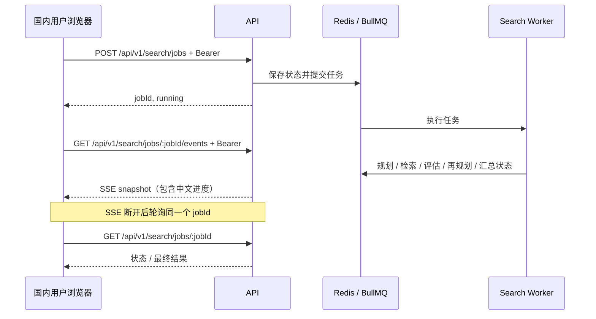

# 搜索异步任务与 SSE 接入说明

## 已实现链路



通信使用“短 HTTP 提交 + SSE 单向推送 + 短 HTTP 查询兜底”。SSE 本身仍基于 HTTP，搜索工作不绑定 SSE 请求生命周期。浏览器通过 Axios fetch adapter 携带现有 Authorization 头，复用令牌刷新逻辑，不将访问令牌放入 URL。

## 接口约定

三个接口均需当前登录用户的 Bearer Token，任务只允许创建者读取。不存在、过期或属于其他用户的任务统一返回 404；未登录按全局鉴权返回 401。

### 创建任务

`POST /api/v1/search/jobs`

请求与现有搜索相同：

```json
{"query":"对比中国与美国近五年的GDP","mode":"mixed","filters":{"countries":[],"regions":[],"entities":[],"indicators":[],"timeRanges":[],"sources":[]}}
```

返回示例：

```json
{"jobId":"任务UUID","status":"running"}
```

`running` 包含等待 Worker 的时间。创建时先校验搜索资格；执行后按现有用量计费逻辑结算，不在提交时预扣。队列提交失败返回 503，并将已创建的状态记为 failed。客户端不对创建请求自动重试；提交响应在网络中丢失时，本版本没有客户端幂等键，直接再次提交可能创建新任务。

### 查询任务

`GET /api/v1/search/jobs/:jobId`

```json
{
  "jobId":"任务UUID",
  "status":"running",
  "query":"对比中国与美国近五年的GDP",
  "progress":{"stage":"replanning","round":2,"message":"证据尚不充分，正在规划补充查询"},
  "error":null,
  "result":null,
  "createdAt":"2026-11-12T03:00:00.000Z",
  "updatedAt":"2026-11-12T03:00:30.000Z"
}
```

- status：`running / completed / failed`；终态以 status 为准，不以 progress 为准。
- progress.stage：`planning / searching / evaluating / replanning / writing`。
- progress.round：可选的实际检索轮次，1～5；原有默认 3 轮、最多 5 轮的规则不变。
- completed：result 为完整的既有 ResearchSearchResponse。
- failed：error 为失败说明。
- progress 不包含模型隐藏思考过程，仅传递流程阶段和中文说明；中英文检索转换仍由现有规划层负责，通信层不改变查询语义。

### 订阅进度

`GET /api/v1/search/jobs/:jobId/events`

请求头：`Authorization: Bearer <accessToken>`、`Accept: text/event-stream`。

响应：`Content-Type: text/event-stream; charset=utf-8`、`Cache-Control: no-cache, no-transform`、`X-Accel-Buffering: no`。

```text
event: snapshot
data: {"jobId":"...","status":"running","query":"...","progress":{"stage":"searching","round":1,"message":"正在从选定来源检索证据"},"error":null,"result":null,"createdAt":"...","updatedAt":"..."}

: heartbeat

```

订阅建立后立即发送最新状态；服务端每秒读取共享状态，仅在快照变化时发送事件，每 15 秒发送心跳。完成或失败时发送终态快照并关闭。快照可以覆盖客户端旧状态，**不是可回放的事件日志**，不提供 Last-Event-ID 或逐条历史重放，短暂阶段可能被合并。

每条 SSE 连接最多维持 60 秒。断开、代理不支持流、30 秒没有任何数据时，前端改用同一任务的 HTTP 查询（默认间隔 2 秒），不会重新创建任务。401/403/404 直接报错。总等待期限默认 10 分钟，覆盖 SSE 与轮询等待中的网络请求；超时或离开页面仅停止前端等待，后台继续执行。任务创建请求单独限时 30 秒。

## 后台执行及 Redis

- Redis 已配置且未启用内存降级时，使用 BullMQ 队列 `research-search`，Worker 与 API 部署在同一应用，每个实例并发 2 个任务。多实例总并发随实例数增加。
- 任务快照存储键为 `search:job:v1:<jobId>`，每次写入续期 7200 秒；任务长时间排队、无更新超过 2 小时将过期。
- 队列任务保留最多 2 小时或 1000 条完成/失败记录。Redis 的数据持久化和高可用需要部署配置；队列不能替代 Redis 的持久化。
- `STORAGE_FALLBACK_TO_MEMORY=true` 或 `REDIS_FALLBACK_TO_MEMORY=true` 时不启用队列，使用进程内后台执行。该模式仅适用于本地开发，重启会丢任务，不能跨实例共享。
- 修正了 Redis 适配器原先将非 localhost 主机直接切成内存存储的问题，远程 Redis 现在使用真实连接。已有远程 Redis 部署应先确认连接配置正确。
- 普通业务失败不自动重跑整轮搜索（attempts=1）。BullMQ 可回收进程中断后的 stalled 任务，因此仍是至少执行一次语义，可能重复外部调用或历史落库。计费 reference 使用 jobId，复用现有月度积分流水唯一约束；跨月重跑仍存在重复结算边界，不能宣称全链路恰好一次。
- Worker 的队列失败事件会尝试将运行中快照标为 failed。Redis 本身不可用时可能无法保存终态，应监控队列失败和存储告警。
- 本次未增加 LangGraph checkpoint，进程中断后的接管会从任务入口重新执行，不从中间节点恢复。

## 部署

1. API 和 Web 同步发布，构建共享 contracts；新 progress 字段是可选字段，保留原有同步接口与 HTTP 查询接口兼容。
2. 生产关闭上述两个内存降级开关，配置真实 Redis；所有 API 实例使用同一个 Redis DB，确认 Redis 持久化策略、容量及连接可达性。
3. 使用更新后的 `deploy/nginx.web.conf`，其中仅 SSE 路径关闭 `proxy_buffering`、缓存与 gzip，并设置 75 秒读超时。上层网关也应关闭该路径缓冲，允许 Authorization 与 text/event-stream。自定义路由若改变 API 前缀，需要同步调整 location。
4. 重载 Nginx 后验证浏览器 Network 中 events 请求持续接收 snapshot/heartbeat，而非到结束才一次性收到。
5. 旧客户端同步接口仍会受到长请求超时影响，面向用户的搜索页已切到异步路径。

## 验收与边界

- 登录用户创建任务后，立即能显示服务端中文阶段与轮次；完成后展示原有结果格式。
- 把 SSE 路径临时阻断，确认页面通过查询接口取得同一 jobId 的结果，且不会再次 POST 创建。
- 用户 B 查询或订阅用户 A 的任务应返回 404，SSE 响应头尚未提交。
- 关闭页面应释放 SSE 订阅和定时器，后台任务继续执行；当前版本页面刷新不会自动恢复 jobId，可从历史记录查看已完成结果。
- 用多实例 + 真实 Redis 验证任一实例可查询状态；重启执行实例验证 stalled 回收，检查重复历史与积分边界。
- 观测任务排队时长、执行时长、运行中数量、队列失败、SSE 断开比例和轮询查询量。SSE 当前采用每连接每秒读一次 Redis；大规模连接时可升级为 Redis Pub/Sub 通知加定期快照校准。
- 本次通信改造没有新增服务端整体执行 deadline、取消任务接口、LangGraph checkpoint、提交幂等键或跨月计费幂等改造。SSE 缓解长连接依赖，但不会缩短模型或上游请求本身耗时。

自动化覆盖 SSE 终态关闭、快照去重、心跳、客户端断开清理、慢消费者、用户隔离、入队失败、并发进度上下文隔离、UTF-8 分片、断流轮询、取消等待与等待期限。真实 Redis 故障接管和实际反向代理环境需要部署验收。
